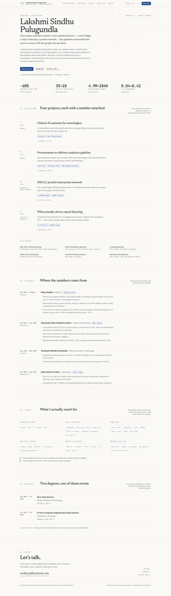
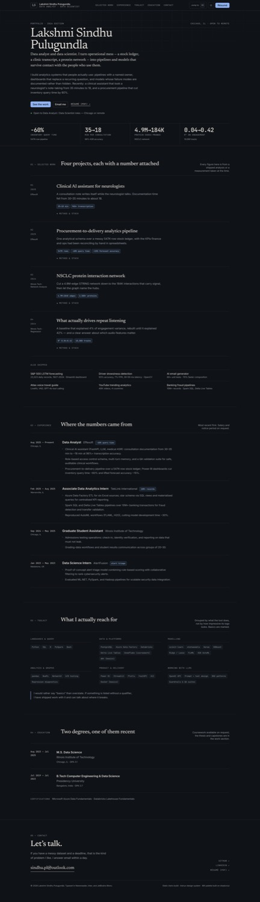
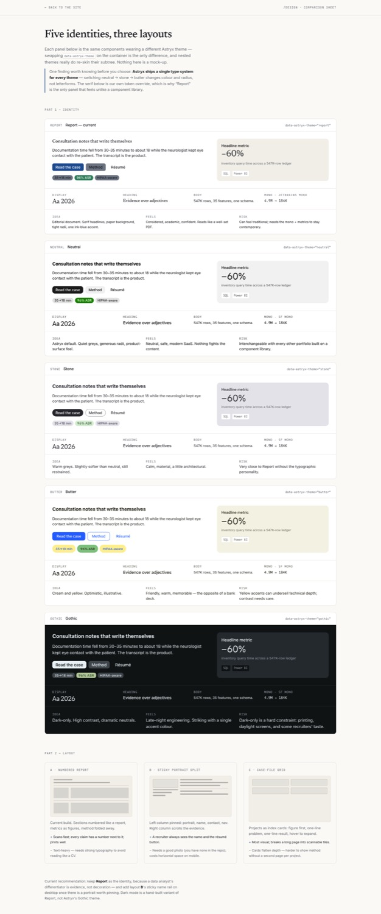

# Portfolio — Lakshmi Sindhu Pulugundla

A recruiter-facing portfolio for a data analyst / data scientist. Static build, no server, no
database: every word comes from one TypeScript file.

**Stack:** [Astro](https://astro.build) 7 (static output) · [Astryx](https://astryx.atmeta.com)
design system · Tailwind CSS v4 · shadcn/ui primitives for the ⌘K palette · self-hosted
Newsreader / Inter / JetBrains Mono.

The previous hand-written version of the site is preserved in [`legacy/`](./legacy) and is **not**
deployed.



<table><tr>
<td></td>
<td></td>
</tr></table>

---

## Run it

```bash
npm install
npm run dev      # http://localhost:4321
npm run build    # → dist/
npm run preview  # serve dist locally
```

Node 22+ is required (Astro 7).

## Where the content lives

Everything a human would want to change is in **[`src/data/profile.ts`](./src/data/profile.ts)**:
name, contact links, the four headline metrics, projects, roles, toolkit, education, certifications,
and the section list used by the nav and the ⌘K palette. The components never hard-code copy.

| I want to… | Edit |
| --- | --- |
| Change the four numbers on the hero | `headlineMetrics` |
| Add or reword a project | `projects[]` (`outcome` is the visible paragraph, `method` sits behind the disclosure) |
| Add a role | `experience[]` — `proof` shows a metric chip next to the title |
| Add a skill | `toolkit[]` groups |
| Change nav labels | `navSections[]` (ids must match the section `id`s) |
| Swap the résumé PDF | replace `public/resume.pdf` |

The résumé PDF in `public/` is the one a visitor downloads. Keep it in sync with `profile.ts`.

## Routes

| Route | What it is |
| --- | --- |
| `/` | The portfolio (one page, five numbered sections) |
| `/design` | Comparison sheet: five Astryx identities and three layout options, rendered live. `noindex` |
| `/404.html` | “No rows matched.” |
| `/robots.txt` | Generated at build time from `site` + `base` |
| `/sitemap-index.xml` | Generated by `@astrojs/sitemap` |

## Deploying

`.github/workflows/deploy.yml` builds and publishes to GitHub Pages on every push to `main`.
It sets two env vars that `astro.config.mjs` reads:

```bash
PUBLIC_SITE_URL=https://lakshmi-sindhu-p.github.io   # no trailing slash
PUBLIC_BASE_PATH=/CV/                               # project pages live under /CV/
```

For a **custom domain**, set `PUBLIC_SITE_URL=https://yourdomain.com` and `PUBLIC_BASE_PATH=/`,
then add the domain in the repo's Settings → Pages. Details and DNS records:
[`docs/DOMAIN.md`](./docs/DOMAIN.md).

Any static host works — `dist/` is just files. Netlify, Cloudflare Pages, and Vercel need no
config beyond the build command `npm run build` and output directory `dist`.

## Repository layout

```
src/
  data/profile.ts        single source of truth for copy
  layouts/BaseLayout.astro   <head>, theme boot script, reveal observer, skip link
  components/site/*      Header, Hero, SelectedWork, Experience, Toolkit, Education, Footer
  components/site/CommandPalette.tsx   the only React island (⌘K)
  components/ui/*        shadcn primitives (command, dialog, button)
  pages/index.astro      the page
  pages/design.astro     the comparison sheet
  styles/global.css      tokens, editorial primitives, print styles
tools/                   screenshot + OG-image scripts (Playwright)
docs/DOMAIN.md           domain provisioning
DESIGN.md                why it looks like this
```

## Notes and open items

- **Dates to confirm.** The two newest résumés disagree on when the Effexoft and TekLink roles
  started (Aug 2025 vs Aug 2024). `profile.ts` uses the 2026 PDF and carries a `TODO(verify)`.
  Fix before sharing widely.
- **Phone number is deliberately not published.** Email is the entry point.
- **Fonts are self-hosted** via `@fontsource-variable`, so there is no Google Fonts request and the
  page renders correctly offline and in the EU.
- **Dark mode is hand-authored** on top of the custom theme (Astryx's published themes are
  light-only except *gothic*, which is dark-only). Toggle in the header; the choice persists in
  `localStorage` and is applied before first paint.
- Screenshot/OG tooling needs a browser: `PLAYWRIGHT_BROWSERS_PATH=.tmp/browsers node tools/shoot.mjs`.
