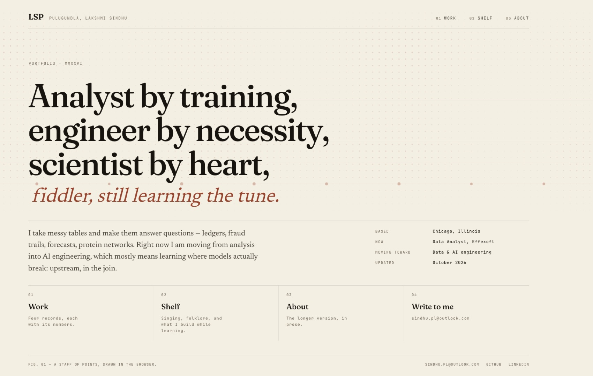
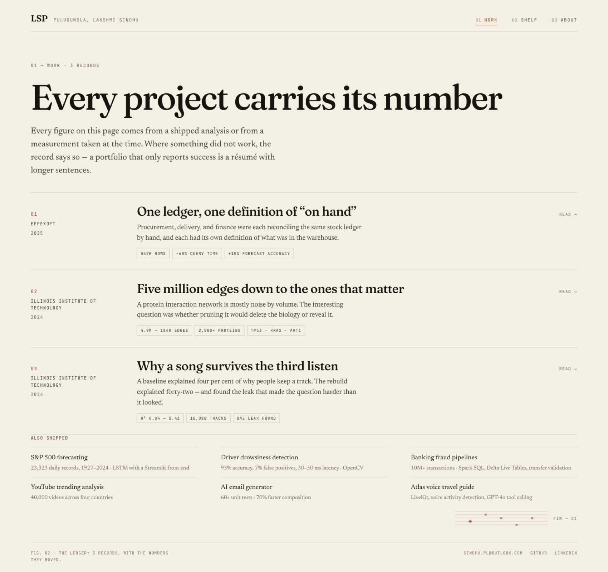
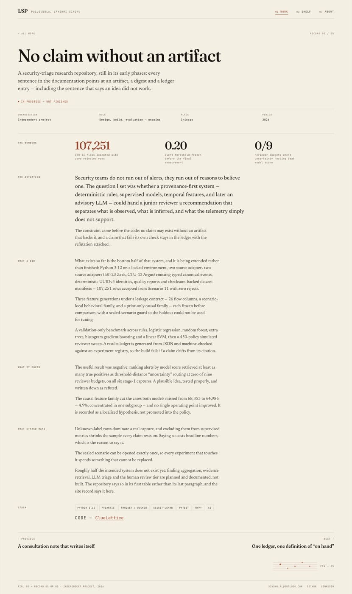
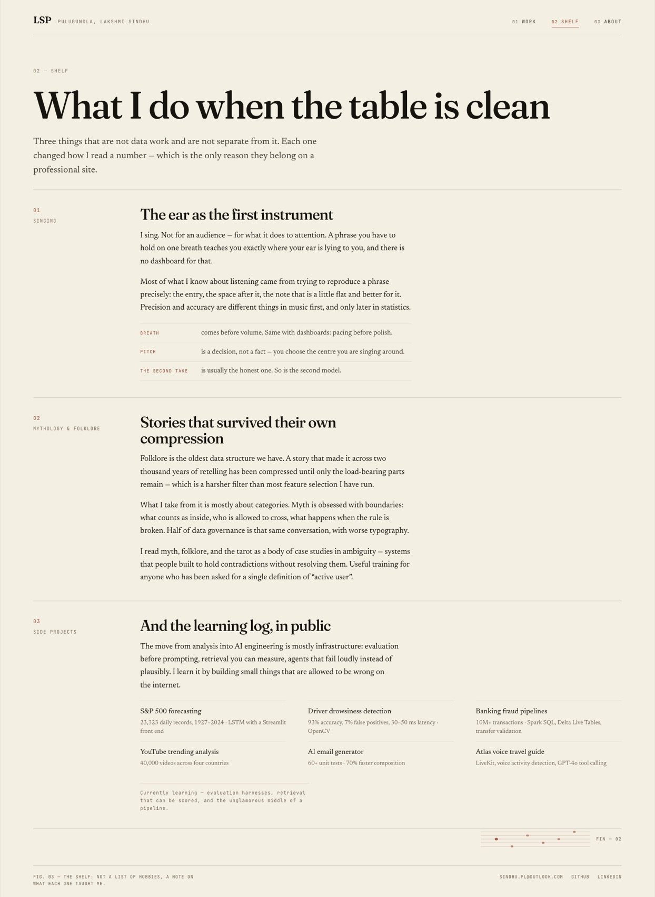
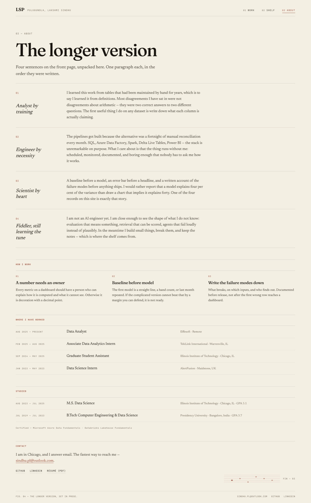

# Portfolio — Lakshmi Sindhu Pulugundla

A four-page portfolio for a data analyst moving into AI engineering. Static build, no server, no
database: every word lives in two structured files.

**Stack:** [Astro](https://astro.build) 7 (static output) · hand-written CSS for the site itself ·
self-hosted Fraunces (variable), Newsreader (variable) and JetBrains Mono · one `<canvas>` for the
staff-of-points texture. Astryx and shadcn remain installed for the `/design` lab page — the public
pages do not depend on them.

The first, single-page version of the site is preserved in [`legacy/`](./legacy) and is **not**
deployed.



| | |
| --- | --- |
|  |  |
|  |  |

---

## Run it

```bash
npm install
npm run dev      # http://localhost:4321
npm run build    # → dist/
npm run preview  # serve dist locally
```

Node 22+ is required (Astro 7). In this workspace `~/.npm` is not writable, so builds run with
`npm_config_cache=$PWD/.tmp/npm-cache`.

## Routes

| Route | What it is |
| --- | --- |
| `/` | The cover: a four-line statement, a staff of points, four doors |
| `/work/` | The ledger — four records with their numbers |
| `/work/<slug>/` | One record: situation, what I did, what it moved, what stayed hard |
| `/shelf/` | Singing, mythology and folklore, side projects and the learning log |
| `/about/` | The four sentences unpacked, how I work, history, contact |
| `/design/` | Design-system lab from the earlier phase. `noindex` |
| `/404.html` | “No rows matched.” |
| `/robots.txt`, `/sitemap-index.xml` | Generated at build time |

## Where the content lives

| I want to… | Edit |
| --- | --- |
| Change the cover statement, lede, or the four meta facts | `src/pages/index.astro` |
| Reword or reorder the four records | `src/data/records.ts` |
| Add a smaller project (work page and shelf) | `alsoShipped[]` in `src/data/records.ts` |
| Add a role or change dates | `experience[]` in `src/data/profile.ts` |
| Change the shelf pieces | `src/pages/shelf.astro` |
| Swap the résumé PDF | replace `public/resume.pdf` |
| Change the name in the header or footer | `src/layouts/Paper.astro` |

Every figure on the site comes from the résumé; the case-study prose was written from the work that
produced those figures. A number appears in two places — the ledger chip and the record's figures —
so change both.

## Deploying

`.github/workflows/deploy.yml` builds and publishes to GitHub Pages on every push to `main`.
It sets two env vars that `astro.config.mjs` reads:

```bash
PUBLIC_SITE_URL=https://lakshmi-sindhu-p.github.io   # no trailing slash
PUBLIC_BASE_PATH=/CV/                               # project pages live under /CV/
```

For a **custom domain**, set `PUBLIC_SITE_URL=https://sindhupulugundla.com` and
`PUBLIC_BASE_PATH=/`, then add the domain in Settings → Pages. DNS records and the registrar
walk-through: [`docs/DOMAIN.md`](./docs/DOMAIN.md).

Any static host works — `dist/` is just files. Netlify, Cloudflare Pages, and Vercel need no config
beyond build command `npm run build` and output directory `dist`.

## Repository layout

```
src/
  data/records.ts          the four work records + the smaller shipped list
  data/profile.ts          experience, education, certifications, contact
  layouts/Paper.astro      shell: head, header, footer, tokens, type primitives
  components/paper/StaffCanvas.astro   the canvas staff (reduced-motion aware)
  components/paper/StaffRule.astro     the static five-line phrase used as a fin
  pages/index.astro        the cover
  pages/work/index.astro   the ledger
  pages/work/[slug].astro  the record template
  pages/shelf.astro        the shelf
  pages/about.astro        the longer version
  pages/design.astro       Astryx/shadcn lab (noindex, not linked from the site)
  layouts/BaseLayout.astro legacy shell used only by /design
tools/                     Playwright screenshot harness
docs/DOMAIN.md             domain provisioning
docs/ia-research.md        which multipage shapes exist, and how much people reveal
docs/references.md         the nine reference sites the design was drawn from
DESIGN.md                  why it looks like this
```

## Notes and open items

- **Dates are confirmed** (Oct 2026): Effexoft Aug 2025–Present, TekLink Feb 2025–Aug 2025. An older
  résumé draft in the archive says 2024 — it is wrong, and `profile.ts` now carries a comment saying
  so, so nobody "fixes" it back.
- **The “fiddler” line is a pun, not a claim** to play the violin. If the fiddle is literal, say so
  and the shelf can carry it.
- **The shelf needs specifics.** Singing and folklore currently describe the practice, not a
  repertoire — no song titles, no reading list. Three or four real names would make it sing.
- **Phone number is deliberately not published.** Email is the entry point.
- **Fonts are self-hosted** via `@fontsource-variable`: no Google Fonts request, works offline.
- **The texture is one canvas**: device pixel ratio capped at 2, paused when the tab is hidden,
  reduced to a single still frame under `prefers-reduced-motion`.
- Screenshot tooling needs a browser:
  `PLAYWRIGHT_BROWSERS_PATH=.tmp/browsers node tools/shoot-paper.mjs` (serves `dist` on :4399).
